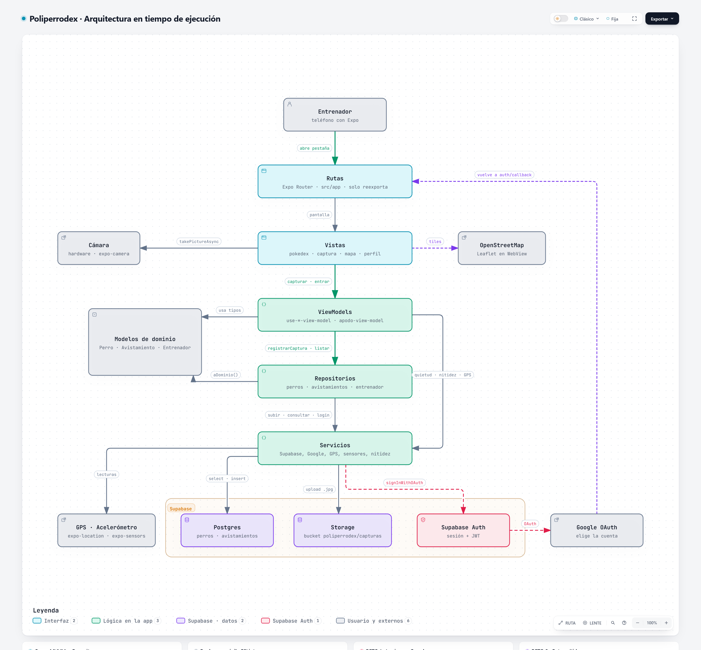

# Poliperrodex · Retos del Taller 8

## Reto 1 · Login con Google en lugar del apodo

**Qué cambió en la capa de datos (lo que pedía el taller):**

| Archivo | Cambio |
|---|---|
| `src/data/repositories/entrenador-repository.ts` | El entrenador ya no es un apodo guardado en el teléfono: sale de la sesión de Supabase Auth. El apodo es la parte del correo antes de la `@` (minúsculas, máx. 20). |
| `supabase/04_reto_login_google.sql` | La política de inserción ya no es `with check (true)` para `anon`: solo `authenticated`, y el `apodo` tiene que ser el de su propio correo (se calcula desde el JWT). |

Para que eso funcione se agregaron piezas de soporte (no cambian la lógica de las demás capas):

- `src/data/services/google-auth-service.ts`: el flujo OAuth (Supabase → navegador → Google → de vuelta a la app).
- `src/data/services/supabase-service.ts`: el cliente guarda la sesión (AsyncStorage) y refresca el token.
- `src/domain/models/entrenador.ts`: el modelo `Entrenador`.
- UI: `formulario-login.tsx` reemplaza a `formulario-apodo.tsx`; `apodo-view-model.tsx` expone `entrarConGoogle` y `cerrarSesion`; la ruta `app/auth/callback.tsx` recibe el regreso de Google.

Las pantallas siguen leyendo `apodo` igual que antes: Pokédex, captura y mapa no cambiaron su lógica.

**Por qué es más seguro:** antes cualquiera con la clave publicable podía insertar avistamientos con el apodo de otro. Ahora la base de datos compara el apodo con el correo del token, así que aunque alguien modifique la app, no puede capturar a nombre de otro.

**Límite conocido:** si la parte del correo antes de la `@` tiene menos de 3 letras, el `CHECK` de la tabla rechaza la captura.

## Reto 2 · Fotos borrosas o distorsionadas

### Causas encontradas

1. **Movimiento al disparar.** Al tocar el botón, la mano empuja el teléfono justo cuando se abre el obturador. Eso produce desenfoque por movimiento y, en cámaras con *rolling shutter*, líneas inclinadas o "estiradas" (la distorsión).
2. **Compresión fuerte.** `quality: 0.6` mete bloques JPEG que se ven como borrosidad.
3. **Enfoque.** En Android `expo-camera` no permite fijar el enfoque desde la app (`autofocus` es solo iOS), así que no hay forma de forzarlo; solo se puede comprobar el resultado.

### Solución implementada (3 capas)

1. **Esperar a que el teléfono esté quieto** (`acelerometro-service.ts → esperarQuietud`). Antes de disparar se mira el acelerómetro: si la desviación estándar de la aceleración en las últimas ~0,3 s es menor a 0,04 g, se dispara. Si en 1,5 s no se queda quieto, dispara igual y decide el paso 2.
2. **Medir la nitidez y rechazar la foto movida** (`nitidez-service.ts → medirNitidez`). Se usa la **varianza del Laplaciano**: se achica la foto a 400 px, se pasa a escala de grises, se aplica el Laplaciano (cuánto difiere cada píxel de sus 4 vecinos) y se calcula la varianza. Bordes marcados dan un valor alto; una foto borrosa da un valor bajo. Si queda por debajo de `NITIDEZ_MINIMA` (60), no se gasta GPS ni subida: se le pide al usuario repetir.
3. **Mejor calidad sin pasar el límite del bucket** (`prepararParaSubir`). La cámara toma con `quality: 0.9` y el repositorio redimensiona a 1600 px de ancho manteniendo la proporción (el alto se calcula solo, así que la foto no se deforma), con JPEG 0,85.

**Calibración:** en la consola de Metro sale `Nitidez: X (mínimo 60)`. Hay que tomar unas fotos buenas y unas movidas a propósito y ajustar `NITIDEZ_MINIMA` en `use-captura-view-model.ts` a un valor intermedio.

**MVVM:** el sensor y el análisis de imagen están en `data/services`, el ViewModel decide el orden (`estabilizando → fotografiando → revisando → ubicando → guardando`) y la vista solo muestra el texto de cada paso.

### Fuentes

- Pech-Pacheco, J. L., Cristóbal, G., Chamorro-Martínez, J., Fernández-Valdivia, J. (2000). *Diatom autofocusing in brightfield microscopy: a comparative study*. ICPR 2000 (origen de la varianza del Laplaciano como medida de enfoque).
- A. Rosebrock, [Blur detection with OpenCV](https://pyimagesearch.com/2015/09/07/blur-detection-with-opencv/), PyImageSearch.
- [Expo Camera](https://docs.expo.dev/versions/latest/sdk/camera/): `takePictureAsync`, `quality`, `autofocus` solo iOS.
- [Expo ImageManipulator](https://docs.expo.dev/versions/latest/sdk/imagemanipulator/): redimensionar y comprimir.
- [Expo Sensors · Accelerometer](https://docs.expo.dev/versions/latest/sdk/accelerometer/).

## Reto 3 · Diagrama con Archify

```bash
npx skills add tt-a1i/archify
```

Luego, en el agente: *"Usa archify para generar el diagrama de arquitectura de tiempo de ejecución de alto nivel de este proyecto."* Guarda la imagen en `docs/arquitectura.png` y enlázala aquí.



Versión interactiva: [docs/arquitectura.html](docs/arquitectura.html)
